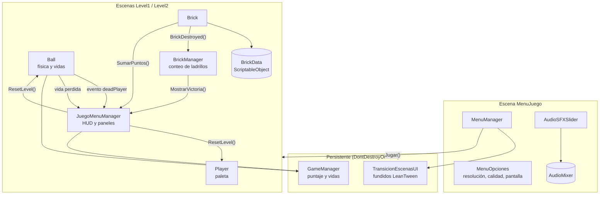
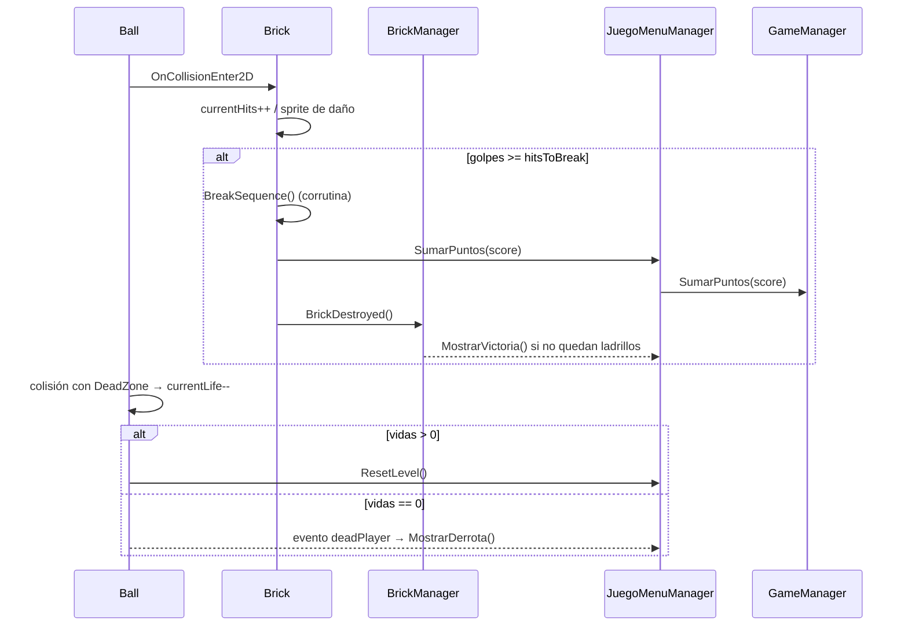

# ArkanoidReversionado


Juego 2D de rompe-ladrillos estilo arcade desarrollado en **Unity 6** y **C#**. Reinterpreta la mecánica clásica del género con un sistema de ladrillos configurable mediante **ScriptableObjects**, física 2D con corrección anti-bucles para la pelota, gestión de estado persistente entre escenas y menús con transiciones animadas.

El objetivo del proyecto es aplicar buenas prácticas de desarrollo de videojuegos: separar datos de comportamiento, desacoplar componentes mediante eventos y mantener la lógica de cada sistema en scripts con una única responsabilidad.

> **Demo:** [Gameplay Arkanoid.mp4](Gameplay%20Arkanoid.mp4) — video de gameplay incluido en el repositorio.

---

## Tabla de contenidos

- [Características](#características)
- [Stack tecnológico](#stack-tecnológico)
- [Arquitectura](#arquitectura)
- [Sistemas destacados](#sistemas-destacados)
- [Estructura del proyecto](#estructura-del-proyecto)
- [Requisitos previos](#requisitos-previos)
- [Instalación y ejecución](#instalación-y-ejecución)
- [Controles](#controles)
- [Configuración de ladrillos](#configuración-de-ladrillos)
- [Licencia](#licencia)
- [Autor](#autor)

---

## Características

- **Dos niveles jugables** (`Level1`, `Level2`) y un menú principal (`MenuJuego`).
- **Ladrillos data-driven**: resistencia, puntaje y sprites de daño/destrucción definidos en assets `BrickData`, sin modificar código.
- **Feedback visual progresivo**: el sprite del ladrillo cambia con cada golpe y reproduce una animación de ruptura por corrutina.
- **Física anti-atasco**: la pelota detecta trayectorias casi horizontales o verticales y corrige el ángulo conservando la velocidad.
- **Sistema de vidas y puntaje persistente** entre escenas mediante un `GameManager` singleton.
- **Detección de victoria** automática al destruir todos los ladrillos del nivel.
- **Menú de pausa, controles, victoria y derrota** dentro del juego.
- **Menú de opciones**: resolución (filtrada por tasa de refresco del monitor), pantalla completa, calidad gráfica y volumen de efectos.
- **Volumen en escala logarítmica (dB)** aplicado sobre un `AudioMixer` y persistido con `PlayerPrefs`.
- **Transiciones de fundido** entre escenas y paneles con LeanTween.
- **Efectos de sonido** diferenciados para paleta, ladrillos, paredes y zona de muerte.

---

## Stack tecnológico

| Categoría | Tecnología |
|---|---|
| Motor | Unity 6 (`6000.0.63f1`) |
| Lenguaje | C# |
| Render | Universal Render Pipeline (URP 2D) — `com.unity.render-pipelines.universal 17.0.4` |
| Física | Physics 2D (`Rigidbody2D`, `PhysicsMaterial2D` sin fricción y rebote 1) |
| UI | uGUI + TextMesh Pro |
| Animación / Tweens | [LeanTween](https://github.com/dentedpixel/LeanTween) (incluido en `Assets/LeanTween`) |
| Audio | `AudioMixer` (`MixerJuego.mixer`) + `AudioSource` |
| Input | Input Manager clásico (`Input.GetAxisRaw`, `Input.GetKeyDown`); Input System 1.16 instalado con manejo de input en modo *Both* |
| Persistencia | `PlayerPrefs` (volumen de efectos) |
| Plataforma de build | PC (Windows) |

---

## Arquitectura

El proyecto sigue la arquitectura basada en componentes de Unity, con responsabilidades separadas por script y comunicación mediante referencias, eventos C# y un singleton de estado global.



### Responsabilidad de cada script

| Script | Responsabilidad |
|---|---|
| `GameManager` | Singleton persistente con el puntaje total y las vidas actuales/máximas. |
| `Ball` | Lanzamiento con dirección aleatoria, corrección anti-atasco en `FixedUpdate`, sonidos por tipo de colisión, pérdida de vidas y evento `deadPlayer`. |
| `Player` | Movimiento horizontal de la paleta por fuerzas sobre `Rigidbody2D` y reposicionamiento. |
| `Brick` | Conteo de impactos, actualización de sprites de daño, secuencia de ruptura y suma de puntos. |
| `BrickData` | ScriptableObject con golpes necesarios, puntaje y sprites de cada tipo de ladrillo. |
| `BrickManager` | Cuenta los ladrillos hijos del nivel y dispara la victoria al llegar a cero. |
| `JuegoMenuManager` | HUD (puntaje y vidas), pausa, controles, victoria, derrota, reinicio y cambio de nivel. |
| `MenuManager` | Navegación del menú principal (controles, opciones, créditos) e inicio del juego. |
| `MenuOpciones` | Resolución, pantalla completa y nivel de calidad gráfica. |
| `AudioSFXSlider` | Conversión del slider a decibeles y persistencia del volumen de efectos. |
| `TransicionEscenasUI` | Singleton de fundidos de entrada, salida y entre paneles con `CanvasGroup` + LeanTween. |
| `GameOverScene` | Reinicio cargando `Level1`. |

### Flujo de una partida



---

## Sistemas destacados

### Ladrillos configurables con ScriptableObjects

Cada tipo de ladrillo referencia un asset `BrickData` (menú *Create → Scriptable Objects → BrickData*). Agregar una variante nueva es crear un asset y asignarlo al prefab, sin tocar código.

```csharp
[CreateAssetMenu(fileName = "BrickData", menuName = "Scriptable Objects/BrickData")]
public class BrickData : ScriptableObject
{
    public int hitsToBreak = 1;      // golpes necesarios
    public Sprite[] damageSprites;   // sprite por estado de daño
    public int score = 50;           // puntos al destruirlo
    public Sprite[] breakSprites;    // animación de ruptura
}
```

### Corrección anti-atasco de la pelota

Un problema habitual del género es que la pelota quede rebotando en un bucle perfectamente horizontal o vertical. En `Ball.FixedUpdate` se detecta cuando una componente de la velocidad cae por debajo de `stuckEpsilon` y se aplica un ángulo aleatorio acotado, respetando el sentido de movimiento y garantizando una velocidad mínima (`minSpeed`).

```csharp
bool nearHorizontal = Mathf.Abs(v.y) < stuckEpsilon;
bool nearVertical   = Mathf.Abs(v.x) < stuckEpsilon;
// ...se recalcula la dirección y se conserva la magnitud
rigidBall.linearVelocity = newDir.normalized * currentSpeed;
```

### Volumen en decibeles

El oído humano percibe el volumen de forma logarítmica, por eso el slider (0–1) se convierte a dB antes de aplicarse al `AudioMixer`. El valor se limita a `0.001` para evitar `Log10(0)`:

```csharp
float volumeDB = Mathf.Log10(Mathf.Clamp(value, 0.001f, 1f)) * 20f;
mixer.SetFloat("SFXVolume", volumeDB);
```

### Desacoplamiento por eventos

`Ball` expone `event EventHandler deadPlayer`. `JuegoMenuManager` se suscribe en `OnEnable` y se desuscribe en `OnDisable`, de modo que la pelota no necesita conocer la UI de derrota.

---

## Estructura del proyecto

```text
ArkanoidReversionado/
├── Assets/
│   ├── Fonts/                  # Fuente pixel del HUD y menús
│   ├── LeanTween/              # Librería de tweens (terceros)
│   ├── Physics Material/       # Ball Physics (fricción 0, rebote 1)
│   ├── Prefabs/                # Ball, Player, ladrillos, rocas, madera y UI del juego
│   ├── Scenes/                 # MenuJuego, Level1, Level2
│   ├── Scrips/                 # Scripts C# del juego
│   │   └── ScripObject/        # Assets BrickData de cada tipo de ladrillo
│   ├── Settings/               # Configuración de URP 2D
│   ├── Sounds/                 # Efectos .wav y AudioMixer
│   ├── Sprites/                # Sprites de ladrillos, vidas y sprite sheet general
│   └── TextMesh Pro/           # Recursos de TMP
├── Build/PC/                   # Build ejecutable para Windows
├── Packages/                   # manifest.json de Unity Package Manager
├── ProjectSettings/            # Configuración del proyecto y build
├── Gameplay Arkanoid.mp4       # Video de demostración
└── LICENSE
```

---

## Requisitos previos

- **Unity Hub**
- **Unity Editor 6000.0.63f1** (Unity 6). Otras versiones de Unity 6 pueden funcionar, pero es la versión con la que se creó el proyecto.
- Módulo **Windows Build Support** si se desea generar el ejecutable.
- Un IDE para C#: Visual Studio o JetBrains Rider (ambos integrados en `Packages/manifest.json`).

Las dependencias de Unity (URP, 2D, uGUI, Input System, TextMesh Pro, etc.) se resuelven automáticamente desde `Packages/manifest.json` al abrir el proyecto.

---

## Instalación y ejecución

### Jugar sin Unity (Windows)

El repositorio incluye un build para PC en `Build/PC/`:

```bash
git clone https://github.com/EnzoDalmasso/ArkanoidReversionado.git
```

Luego ejecutá `Build/PC/ArkanoidReversionado.exe`.

### Abrir el proyecto en Unity

1. Cloná el repositorio con el comando anterior.
2. Abrí **Unity Hub → Add → Add project from disk** y seleccioná la carpeta raíz del proyecto.
3. Abrilo con Unity `6000.0.63f1` y esperá a que se importen los assets y paquetes.
4. Abrí la escena `Assets/Scenes/MenuJuego.unity`.
5. Presioná **Play**.

### Generar un build

Las escenas ya están registradas en **File → Build Profiles** en este orden:

| Índice | Escena |
|---|---|
| 0 | `MenuJuego` |
| 1 | `Level1` |
| 2 | `Level2` |

Seleccioná la plataforma **Windows** y ejecutá **Build** apuntando a `Build/PC/`.

---

## Controles

| Tecla | Acción |
|---|---|
| `←` / `→` o `A` / `D` | Mover la paleta |
| `Esc` | Pausar / reanudar |
| `R` | Reiniciar el nivel actual |

---

## Configuración de ladrillos

Valores definidos en `Assets/Scrips/ScripObject`:

| Asset | Golpes para romper | Puntos |
|---|---:|---:|
| `WoodDate` (madera) | 1 | 10 |
| `BrickYellow` | 2 | 20 |
| `BrickOrange` | 3 | 30 |
| `BrickGreen` | 4 | 40 |
| `BrickBlue` | 5 | 40 |
| `BrickRed` | 6 | 50 |
| `BrickPurple` | 7 | 60 |

El jugador comienza con **3 vidas** (`GameManager.vidaMax`). Los prefabs de roca no incluyen el componente `Brick`, por lo que actúan como obstáculos que no se destruyen ni cuentan para la victoria.

---

## Licencia

Distribuido bajo licencia **MIT**. Ver [LICENSE](LICENSE).

LeanTween es una librería de terceros incluida en `Assets/LeanTween` y se rige por su propia licencia.

---

## Autor

**Enzo Dalmasso**

- GitHub: [@EnzoDalmasso](https://github.com/EnzoDalmasso)
- Portfolio: [porfolio-enzo-dalmasso.vercel.app](https://porfolio-enzo-dalmasso.vercel.app/)
